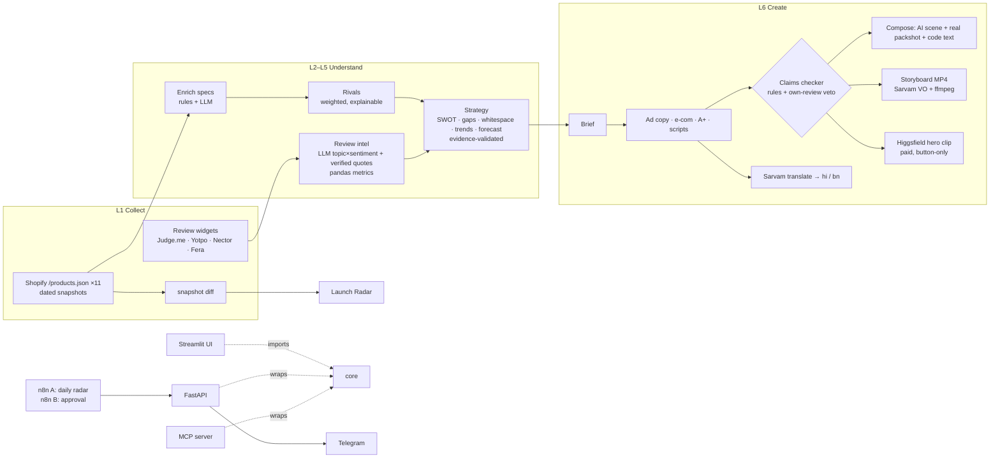

# SignalStudio — Dot & Key market intelligence → marketing content

Built for the Dot & Key brief (Vibe Coders Hackathon Ed. 3). SignalStudio studies the market for Dot & Key products
(11 Shopify catalogues, real customer reviews from each store's own review widget), turns that into evidenced
strategy, and then into marketing content — static ads, e-commerce copy, A+ modules, scripts, storyboard videos,
regional Hindi/Bengali versions and an AI hero clip. Hero category: **sunscreen** (second: **lip balm**).

**Rules the system follows:** never invent data · numbers come from pandas, not the LLM · every insight and ad line
carries evidence ids, and a validator drops anything without them · paid calls are budget-capped, cached and logged.

## Architecture



| Layer | Code | What it does |
|---|---|---|
| L1 | `core/collect/catalog.py`, `core/collect/reviews.py` | Paged `/products.json`, normalised rows (MRP, discount, size, ₹/ml), dated snapshots + diff; review fetchers per widget, coverage file |
| L2 | `core/enrich.py` | Regex/lexicon spec extractor + one cached LLM call per product (pydantic `ProductSpec`, null when unknown) |
| L3 | `core/rivals.py` | `0.35·format + 0.25·ingredient&claim Jaccard + 0.20·price closeness + 0.20·skin overlap`, readable reasons |
| L4 | `core/reviews_intel.py` | Batches of 40 → `{review_id, topics:[{topic, sentiment, quote}]}`; quotes must be exact substrings; pandas metrics; "I wish…" miner |
| L5 | `core/strategy.py` | Gap map, whitespace, launch trends, review-velocity forecast (estimate), opportunity score (estimate), SWOT/improvements/concepts/GTM with evidence validation |
| L6 | `core/creative/*`, `core/audit.py` | Brief, brand kit (k-means palette from packshots, voice stats), ads, e-com, A+, audit before/after, claims, composer, storyboard video, hero clip, ZIP pack |
| Providers | `core/providers/*` | Anthropic/Gemini (`core/llm.py`), Higgsfield, Cloudflare FLUX, Pollinations, Sarvam, Telegram — endpoints quoted from docs in each file |

## Run it

```bash
make setup            # uv venv (Python 3.12) + requirements
cp .env.example .env  # add keys (all optional — see below)
make collect          # polite catalogue snapshot (one round)
make demo             # analysis + one campaign:  python scripts/run_pipeline.py --category sunscreen --campaign
make app              # Streamlit on :8501
make api              # FastAPI on :8000 (for n8n / Telegram links)
make test             # parser, diff, rival scoring, evidence validator, claims checker
```

**Keys** (`.env`): `ANTHROPIC_API_KEY` (or `GEMINI_API_KEY`) turns on the LLM layers; without it the app runs on the
deterministic lexicon/template engines and says so. `SARVAM_API_KEY` → Hindi/Bengali text + voiceover.
`CF_ACCOUNT_ID`/`CF_API_TOKEN` → FLUX backgrounds (else Pollinations, else Pillow). `HIGGSFIELD_API_KEY` +
`HIGGSFIELD_API_SECRET` → hero clip (capped by `HIGGSFIELD_MAX_USD`, default 5). `TELEGRAM_BOT_TOKEN` +
`TELEGRAM_CHAT_ID` → alerts. `DRY_RUN=1` skips every paid call.

## Demo flow (2 minutes)
1. **Market overview** → *Run analysis* (stepper: Catalogue ✓ → Enrich ✓ → Reviews ✓ → Review intelligence ✓ → Rivals ✓ → Gaps ✓ → Strategy ✓). Click a complaint bar → the real reviews behind it.
2. **Product deep-dive** → top-5 rivals with reasons, brand × topic heatmap with n per cell.
3. **SWOT & gaps** → evidenced SWOT, gap map, whitespace, opportunity estimate, launch trends, forecast, concepts, GTM.
4. **Listing audit** → coverage score, before / after.
5. **Creative studio** → persona → *Generate campaign*: brief with evidence, 3 ad variants × 3 sizes (claims badges, "Why this line?"),
   e-com + A+, 15 s / 30 s scripts + storyboard MP4, claims probes (watch "Zero white cast" get blocked if our own reviews disagree),
   regional Hindi/Bengali, Higgsfield hero clip (cost shown first).
6. **🎲 Surprise me** picks a random real Dot & Key product (its real packshot and description) and runs the same chain.

## Automation
- **n8n** (`bash scripts/start_n8n.sh` — needs Node.js; reads keys from `.env` — then *Import from file*): `n8n/launch_radar.json` (08:00 IST → `GET /api/radar` → IF → Telegram) and
  `n8n/campaign_approval.json` (Webhook → `POST /api/campaign` → Telegram with Approve/Reject buttons pointing at the Wait node's
  `$execution.resumeUrl?decision=…` → IF → `POST /api/campaign/{id}/regional` → "pack ready ✅").
  Set n8n env vars: `SIGNALSTUDIO_API` (e.g. `http://localhost:8000`), `SIGNALSTUDIO_TOKEN` (= `API_TOKEN`),
  `TELEGRAM_BOT_TOKEN`, `TELEGRAM_CHAT_ID`, and `N8N_BLOCK_ENV_ACCESS_IN_NODE=false`. Put the webhook's production URL in
  `N8N_APPROVAL_WEBHOOK_URL`. Telegram needs a public `resumeUrl` for the buttons (e.g. `WEBHOOK_URL=https://<tunnel>`).
- **Fallback:** without n8n, *Send for approval* posts straight to Telegram and the buttons hit
  `GET /api/campaign/{id}/decision` on FastAPI, which builds the regional pack and sends the ZIP.
- Pitch: Telegram today, WhatsApp Business API in production.

## Agent mode (MCP)
`mcp_server.py` exposes `list_products`, `get_rivals`, `review_insights`, `market_gaps`, `generate_campaign`, `radar`, `run_analysis`.

Claude Code:
```bash
claude mcp add signalstudio -- /ABS/PATH/.venv/bin/python /ABS/PATH/mcp_server.py
```
Claude Desktop (`claude_desktop_config.json`):
```json
{"mcpServers": {"signalstudio": {"command": "/ABS/PATH/.venv/bin/python", "args": ["/ABS/PATH/mcp_server.py"]}}}
```
Try: *"Which Dot & Key sunscreen has the weakest white-cast sentiment vs its rivals? Generate a Bengali campaign for it for the outdoor-mom persona."*
Higgsfield's own MCP server (`https://mcp.higgsfield.ai/mcp`) can be added alongside for ad-hoc generation.

## Trust
- **Accuracy:** label 30 reviews on *Label reviews*, then `make eval` → topic F1 + sentiment agreement shown on *Accuracy & method*.
- **Coverage:** per product — provider, reviews collected, count/average shown on the site, or the reason it's unavailable.
- **Cost:** every paid call (estimated + actual) in `data/cost_log.jsonl`, totals in the sidebar and on the Trust page.
- **Method notes & caveats:** see `DECISIONS.md`.

## Host it (free): Streamlit Community Cloud
The repo carries everything a visitor needs to explore without any keys: catalogue snapshots, real reviews,
AI labels, insights, generated campaigns (images, MP4s, Hindi/Bengali) and the LLM/scene cache. Keys never go in git.

1. Push this repo to GitHub (public or private). `.env` and `.streamlit/secrets.toml` are git-ignored.
2. Go to **share.streamlit.io** → sign in with GitHub → **Create app** → pick the repo, branch `main`,
   main file `app/streamlit_app.py`. Under **Advanced settings** choose **Python 3.12**.
3. In **Advanced settings → Secrets**, paste the contents of `.streamlit/secrets.toml.example` with your real values.
   Set `APP_PASSCODE`: anyone can browse, but generating new content (which spends API credits) asks for it once.
4. Deploy. `packages.txt` installs ffmpeg; first boot takes ~3–5 min.
5. To update the hosted data, run things locally (or in the app's **Settings & data** page) and push again.

Alternative: Hugging Face Spaces (Streamlit SDK, free CPU) works the same way with its *Secrets* panel.
